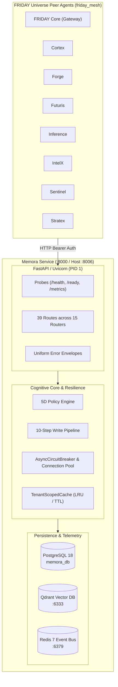

# 🧠 Memora — Centralized Persistent Memory & Cognitive Fabric

[](https://github.com/surendra2304/Memora)
[](LICENSE)
[](https://www.python.org/downloads/)
[](https://www.postgresql.org/docs/)

**Memora** is the centralized persistent episodic memory, knowledge graph, and vector recall engine for all specialist agents in the **FRIDAY Universe** (`FRIDAY`, `Inference`, `Stratex`, `IntelX`, `Futuris`, `Cortex`, `Forge`, `Sentinel`). 

Memora provides URI-partitioned memory namespaces (`memora://<agent>/private`), strict 5-dimension RBAC security policies, automated credential sanitization, multi-tier episodic/semantic/procedural memory retention, and high-concurrency hybrid vector/graph recall.

---

## 🏛️ Ecosystem Topology & Ground Truth

Memora is deployed within the unified private container mesh (`friday_mesh`) on Oracle Cloud Always Free with automated HTTPS reverse proxy via Caddy:

| Dimension | Specification |
| :--- | :--- |
| **Service Identity** | `memora` |
| **Internal Container Port** | `8000` |
| **Host Port Mapping** | `8006:8000` |
| **Internal Mesh URL** | `http://memora:8000` |
| **Public Gateway Path** | `https://friday-universe.duckdns.org/memora/*` |
| **Container Network** | `friday_mesh` |
| **Core Gateway Orchestrator** | `http://friday:10000` |
| **Production Storage Engine** | PostgreSQL 18 (`memora_db`) + Alembic Migrations; SQLite is development/test-only |
| **Vector Engine** | Qdrant (`http://qdrant:6333`) |
| **Distributed Cache / Bus** | Redis 7 (`redis://redis:6379/0`) |

All 8 peer agents interact directly with Memora via HTTP within `friday_mesh` at `http://memora:8000` using bearer authentication (`MEMORA_API_KEY`).



---

## ⚡ Core Architecture & Capabilities

### 1. Multi-Tier Memory Fabric
* **Episodic Memory**: Temporal interaction streams, conversation transcripts, and chronological agent decisions.
* **Semantic Memory**: Knowledge graph nodes, Subject-Predicate-Object (SPO) entity triples, and persistent system facts.
* **Procedural Memory**: Operational playbooks, tool execution parameters, and validated remediation rules.
* **Working Memory**: Dynamic low-latency context window buffers used for active multi-agent turn reasoning.

### 2. URI-Partitioned Namespaces & 5D Policy Engine
Memora strictly enforces access boundaries across three discrete namespace scopes:
- **Private**: `memora://<agent_name>/private` (e.g. `memora://forge/private`) — strictly inaccessible to other agents.
- **Shared**: `memora://teams/<squad_name>/shared` (e.g. `memora://teams/trading-squad/shared`) — accessible only to authorized squad peers.
- **Global**: `memora://universe/global` — read/append commons accessible by the entire ecosystem.

Every read/write is validated against the 5D Policy Engine (`core/policy/engine.py`): Identity, Namespace Grants, Access Purpose, Trust Level, and Lifecycle State.

### 3. Deterministic 10-Step Write Ingestion Pipeline
1. **Secret Scanning**: Scans and blocks high-entropy tokens, API keys, passwords, private keys, and connection strings (`core/security/secret_scanner.py`).
2. **Text Normalization**: Strips adversarial unicode variations, normalizes whitespace, and parses structure.
3. **Entity & Relation Extraction**: Automatic Named Entity Recognition (NER) extracting semantic triples and entities.
4. **Graph Auto-Wiring**: Links extracted entities to the persistent memory knowledge graph (`storage/relational/models.py`).
5. **Deduplication Engine**: Cosine similarity and hash clustering preventing duplicate memory bloat.
6. **5D Policy Validation**: Verifies caller authority over the target namespace.
7. **Relational Persistence**: Atomically writes the relational memory record to the configured PostgreSQL 18 `memora_db` in production (SQLite is development/test-only).
8. **Vector Embedding Ingestion**: Upserts dense vector representations to Qdrant.
9. **Cache Invalidation**: Flushes distributed Redis candidate buffers.
10. **Audit Log Generation**: Writes immutable audit trail entries in the same atomic transaction.

---

## 🗄️ SQLite 3 WAL Concurrency & Alembic Migrations

### Development-only SQLite WAL mode
To guarantee zero lock contention when all 8 agents write and read simultaneously, SQLite 3 is configured in Write-Ahead Logging (WAL) mode:

```python
PRAGMA journal_mode=WAL;
PRAGMA busy_timeout=5000;
PRAGMA synchronous=NORMAL;
```

- **Development only**: WAL can help local test/dev concurrency; it is not the production multi-agent storage backend.
- **5000ms Busy Timeout**: Contended writes automatically retry with exponential backoff up to 5 seconds.
- **Zero-Downtime Checkpointing**: On container termination (`SIGTERM`/`SIGINT`), Memora flushes active transactions, executes `PRAGMA wal_checkpoint(TRUNCATE);`, and closes database connection pools cleanly within 5 seconds.

### Alembic Migration Lifecycle
Database schemas are versioned and managed with Alembic. Migrations are executed automatically before the API starts in production Docker containers.

```bash
# Apply all pending migrations to the database
alembic upgrade head

# Roll back the most recent migration
alembic downgrade -1

# Roll back all migrations to base state
alembic downgrade base

# Generate a new migration after updating SQLAlchemy models
alembic revision --autogenerate -m "describe_schema_change"
```

---

## 🌐 Health, Readiness & Observability Contracts

Memora provides standardized health check, readiness, and telemetry endpoints for Docker, Kubernetes, and reverse-proxy probes.

### 1. `GET /health` (Liveness Probe)
Returns `HTTP 200 OK` (or `503 Degraded`) with process liveness and storage status:
```json
{
  "status": "healthy",
  "service": "memora",
  "version": "2.0.0",
  "evidence_class": "process_liveness",
  "observed_at": "2026-10-14T21:45:00.000000+00:00",
  "storage": "postgresql",
  "database": "healthy",
  "database_backend": "postgresql",
  "database_durable": true,
  "vector_store": {"status": "connected", "available": true}
}
```

### 2. `GET /ready` (Readiness Probe)
Verifies database connection pool, SQLite WAL mode, vector store connectivity, and circuit breaker status before receiving traffic:
```json
{
  "status": "ready",
  "service": "memora",
  "version": "2.0.0",
  "database": "healthy",
  "wal": "wal_active",
  "vector_store": "connected",
  "circuits": "healthy",
  "evidence_class": "readiness_probe",
  "observed_at": "2026-10-14T21:45:00.000000+00:00"
}
```

### 3. `GET /v1/metrics` & `GET /metrics` (Telemetry & SLIs)
- `GET /v1/metrics`: Returns JSON SLI telemetry including `uptime_seconds`, `memory_rss_mb`, `write_success_rate`, `policy_denial_rate`, and percentile latencies (`p50`, `p95`, `p99`).
- `GET /metrics`: Standard Prometheus-formatted scrape endpoint (supports JSON via `Accept: application/json` or `?format=json`).

### 4. Uniform Error Envelope
All error responses (4xx and 5xx) conform to a standardized error envelope:
```json
{
  "detail": "Descriptive error detail",
  "error": "error_code_identifier",
  "message": "Human readable explanation",
  "success": false
}
```

*Note: Accessing `/` or `/dashboard` with header `Accept: text/html` serves the interactive Memora Memory Observatory web dashboard.*

---

## ⚙️ Environment Variable Configuration

| Variable | Type | Default | Description |
| :--- | :--- | :--- | :--- |
| `MEMORA_ENV` | string | `production` | Deployment mode (`production`, `development`, `testing`). |
| `PORT` | integer | `8000` | Internal container HTTP port (Host: `8006`). |
| `HOST` | string | `0.0.0.0` | Listening network interface. |
| `DEBUG` | boolean | `false` | Enable verbose debugging and OpenAPI schema reload. |
| `DATABASE_URL` | string | required PostgreSQL 18 DSN in production | Primary authoritative relational database connection URL. |
| `SQLITE_FALLBACK_URL` | string | `sqlite:///./data/memora.db` | SQLite fallback database path when primary is unreachable. |
| `USE_SQLITE_FALLBACK` | boolean | `false` | Development-only fallback; production refuses SQLite fallback. |
| `MEMORA_SQLITE_AUTHORITATIVE` | boolean | `false` | Legacy SQLite durability flag; must remain false in production. |
| `MEMORA_SQLITE_BUSY_TIMEOUT` | float | `30` | SQLite busy timeout in seconds. |
| `CIRCUIT_BREAKER_FAILURE_THRESHOLD` | integer | `5` | Consecutive failures before circuit opens. |
| `CIRCUIT_BREAKER_RECOVERY_TIMEOUT` | float | `30.0` | Cool-off seconds before probe attempt. |
| `HTTP_CLIENT_TIMEOUT_SECONDS` | float | `10.0` | Default timeout for async pooled HTTP client. |
| `MEMORY_CACHE_TTL_SECONDS` | float | `300.0` | In-memory tenant cache TTL in seconds. |
| `MEMORY_CACHE_MAX_CAPACITY` | integer | `2000` | In-memory cache max items per tenant partition. |
| `REDIS_URL` | string | `redis://redis:6379/0` | Redis connection URL for candidate caching and events. |
| `QDRANT_URL` | string | `http://qdrant:6333` | Qdrant vector database URL. |
| `QDRANT_COLLECTION` | string | `memora_embeddings` | Qdrant vector collection name. |
| `VECTOR_DIMENSION` | integer | `1536` | Vector embedding dimension. |
| `MEMORA_API_KEY` | string | *Required* | Master bearer API key for authenticating requests to Memora. |
| `MEMORA_CORS_ORIGINS` | string | *Whitelisted* | Comma-separated whitelist of allowed browser origins (`https://friday-universe.duckdns.org,http://localhost:8000,http://127.0.0.1:8000,http://localhost:8006,http://localhost:3000`). |
| `FRIDAY_API_KEY` | string | *Optional* | API key for peer `friday` orchestrator agent. |
| `INFERENCE_API_KEY` | string | *Optional* | API key for peer `inference` LLM gateway. |
| `STRATEX_API_KEY` | string | *Optional* | API key for peer `stratex` trading agent. |
| `INTELX_API_KEY` | string | *Optional* | API key for peer `intelx` research agent. |
| `FUTURIS_API_KEY` | string | *Optional* | API key for peer `futuris` forecasting agent. |
| `CORTEX_API_KEY` | string | *Optional* | API key for peer `cortex` web automation agent. |
| `FORGE_API_KEY` | string | *Optional* | API key for peer `forge` code engineering agent. |
| `SENTINEL_API_KEY` | string | *Optional* | API key for peer `sentinel` security agent. |
| `DEFAULT_CONFIDENCE_THRESHOLD` | float | `0.75` | Minimum confidence score for promoting experiences. |
| `DEFAULT_IMPORTANCE_THRESHOLD` | float | `0.50` | Minimum importance score for memory persistence. |

---

## 🚀 Quickstart & Local Execution

### 1. Run with Docker Compose
```bash
# Copy and configure environment variables
cp .env.example .env

# Build and start Memora on host port 8006
docker compose up -d --build

# Verify logs
docker compose logs -f memora-api
```

### 2. Run Directly in Python (Development)
```bash
# Create virtual environment
python -m venv .venv
source .venv/bin/activate  # Or on Windows: .venv\Scripts\activate

# Install dependencies
pip install -r requirements.txt

# Run migrations
alembic upgrade head

# Start API server on port 8000
uvicorn apps.api.main:app --host 0.0.0.0 --port 8000
```

### 3. Run Test Suite
```bash
# Run complete test suite (534+ tests)
pytest -v

# Run targeted fast tests
pytest tests/test_api.py tests/test_deployment_packaging.py tests/test_cors_configuration.py -v
```
